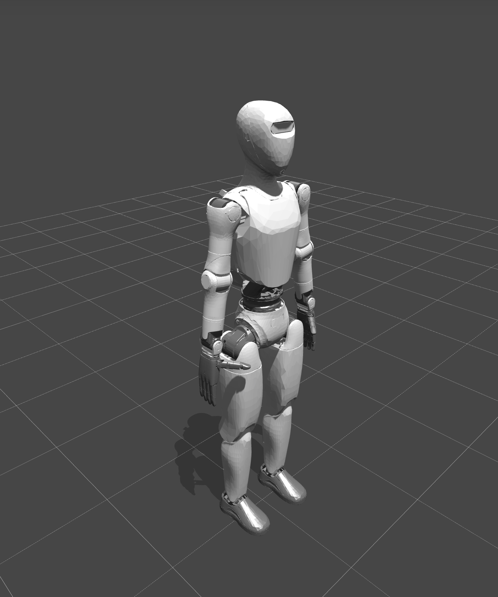
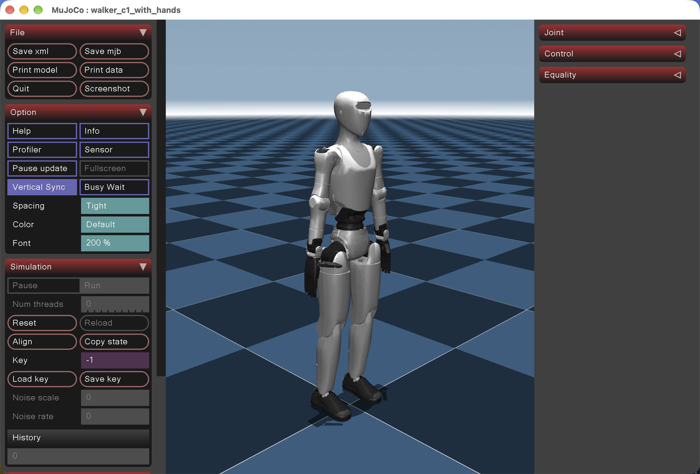
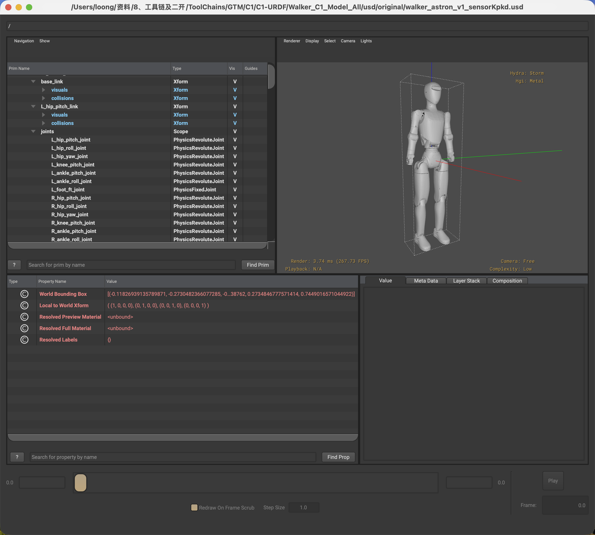
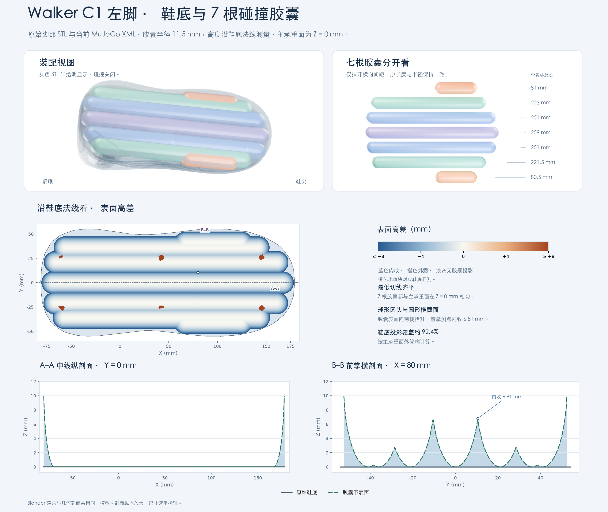

# Walker C1 模型整合包

提供无手、带灵巧手和带假手三种整机 URDF 与对应的 MuJoCo XML、左右手独立 URDF，以及原始和生成的 USD。ROS 2 包名为 `walker_c1_description`。

## 模型截图









## 模型入口

| 文件 | links / joints | 转动关节 | 总质量 |
| --- | --- | --- | --- |
| `urdf/walker_c1.urdf` | 40 / 39 | 31 | 55.31013662 kg |
| `urdf/walker_c1_with_hands.urdf` | 66 / 65 | 53 | 55.7439634304604 kg |
| `urdf/walker_c1_with_dummyhands.urdf` | 42 / 41 | 31 | 55.44413662 kg |
| `urdf/ubt_left_hand_v3_lite.urdf` | 13 / 12 | 11 | 0.2169134052302033 kg |
| `urdf/ubt_right_hand_v3_lite.urdf` | 13 / 12 | 11 | 0.2169134052302033 kg |
| `mujoco/walker_c1.xml` | 对应无手整机；含自由基座、地面 | 31 个力矩执行器 | 同无手版 |
| `mujoco/walker_c1_with_hands.xml` | 对应带手整机；含自由基座、地面 | 53 个力矩执行器 | 同带手版 |
| `mujoco/walker_c1_with_dummyhands.xml` | 对应假手整机；含自由基座、地面 | 31 个力矩执行器 | 同假手版 |
| `usd/original/walker_astron_v1_sensorKpkd.usd` | 原始无手版本；含 5 个相机和 2 个 Isaac IMU | 身体 31 | 原始资产参数 |
| `usd/generated/walker_c1_with_hands.usd` | 由带手 URDF 重建；含 5 个相机和 2 个 Isaac IMU | 53 | 同带手版 |

整机以 `base_link` 为根；独立左右手分别以 `L_hand_base_link`、`R_hand_base_link` 为根，不包含整机腕部安装变换。URDF 长度单位为 m，关节角度为 rad。

## 包内资源

| 路径 | 内容 |
| --- | --- |
| `urdf/` | 三份整机及两份独立手部 URDF |
| `meshes/body/` | 32 个身体原始 STL |
| `meshes/left_hand/`、`meshes/right_hand/` | 左右手各 13 个原始 STL |
| `meshes/visual/` | 左右腕部视觉派生 STL，由灵巧手版和假手版引用 |
| `mujoco/` | 三份整机 XML 和用于网格碰撞的凸包 |
| `usd/original/` | 原始主 USD、5 个子 USD 及附属文件 |
| `usd/generated/` | 由 URDF 重建的单文件带手整机 USD |
| `launch/`、`config/display.rviz` | ROS 2 显示入口和 RViz 配置 |
| `config/hand_mounts.json` | 灵巧手安装参数 |
| `config/collision_exclusions.json` | MuJoCo 额外装配碰撞排除对及原因 |
| `config/*_joints.json` | 关节/执行器顺序、home 姿态及源速度限位 |
| `关键参数/` | 无手版和灵巧手版的 link、joint CSV 参数表 |
| `script/view_mujoco.py` | MuJoCo 查看入口 |
| `script/urdf2usd.py`、`script/foot_collisions.py`、`script/augment_sensors.py` | URDF→USD 转换、C1 脚底布局与传感器搬运 |
| `docs/` | URDF、MuJoCo、USD 展示图和脚底碰撞示意图 |

URDF 网格统一引用 `package://walker_c1_description/meshes/...`，需要安装本 ROS 包，或在所用查看器中将该包名映射到本目录。无须安装额外的手部 ROS 包。MuJoCo 使用包内相对路径，可随整包移动；请勿只复制 XML 而遗漏网格目录。

## 配色与腕部装配

主体为白色 `1 1 1 1`。`waist_yaw_link`、`waist_pitch_link`、左右 `shoulder_pitch_link`、`wrist_pitch_link`、`hip_pitch_link`、`ankle_roll_link` 及双手全部 link 为不透明深灰色 `0.2 0.2 0.2 1`。URDF、独立手部和 MuJoCo 配色一致。

双手直接固定连接腕部，不含旧版腕部六维力传感器及转接链。左右安装参数如下，均相对于对应的 `wrist_roll_link`：

| 安装关节 | xyz (m) | rpy (rad) |
| --- | --- | --- |
| `L_hand_mount_joint` | `0 0 -0.0499` | `pi 0 -pi/2` |
| `R_hand_mount_joint` | `0 0 -0.0499` | `pi 0 pi/2` |

真机连接件已修改为嵌入手部，因此当前装配将双手相对原端面贴合位置沿腕部局部 +Z 各上移 6 mm，安装距离已确认。原始腕部网格仍保留旧结构的 6 mm 台子，嵌入后会外露或与手基座叠加，所以带手版仅在视觉上隐藏该区域。

此处理新增了两份文件，没有覆盖原始 STL 或将整个腕部透明化：

- `meshes/visual/L_wrist_roll_no_flange.STL`
- `meshes/visual/R_wrist_roll_no_flange.STL`

两份文件裁去腕部局部 `z<=-0.0385 m` 区域及台子顶面，切口不封口，位于手基座内部。灵巧手版和假手版的腕部可视几何均引用这两份 STL。URDF 的腕部碰撞沿用完整网格，MuJoCo 使用对应凸包。假手安装点的腕部局部 `Z = −0.0485 m`，灵巧手为 `−0.0499 m`。质量、质心和惯量保持源参数。无手版保留完整腕部外观。该显示处理不等于真机修改后连接件的 CAD 重建，也不表示已验证机械孔位或装配干涉。

## ROS 2 构建与显示

在已安装 ROS 2 的环境中，将本目录放入工作空间的 `src/` 下，或显式指定包路径：

```bash
colcon build --base-paths /path/to/Walker_C1_Model_All --packages-select walker_c1_description
source install/setup.bash
ros2 launch walker_c1_description display.launch.py variant:=no_hands
ros2 launch walker_c1_description display.launch.py variant:=with_hands
```

运行依赖见 `package.xml`。启动文件直接读取 URDF，不需要 xacro 展开。两膝角度下限为 `0.08 rad`，GUI 默认以该角度初始化，其余关节为零；此姿态用于查看，不是站立控制目标。可加 `rviz:=false` 关闭 RViz 启动。

## MuJoCo 查看

在安装了 MuJoCo Python 包的环境中，于本包目录执行。已核验的 MuJoCo 版本为 3.10.0；其他版本未逐一验证。

macOS：

```bash
mjpython script/view_mujoco.py
mjpython script/view_mujoco.py --hands
```

Linux 等环境：

```bash
python script/view_mujoco.py
python script/view_mujoco.py --hands
```

查看器默认暂停，并初始化到 `home` keyframe。加 `--simulate` 可运行无控制器的被动重力仿真；包内没有站立控制器，不能据此期待机器人保持站立。默认隐藏 group 3 的碰撞体，可在查看器中启用该组以检查凸包和脚底胶囊。

在自己的程序中加载 XML 时，显式恢复合法初始姿态：

```python
import mujoco
m = mujoco.MjModel.from_xml_path('mujoco/walker_c1_with_hands.xml')
d = mujoco.MjData(m)
mujoco.mj_resetDataKeyframe(m, d, 0)
mujoco.mj_forward(m, d)
```

若 macOS 的 `mjpython` 报 `otool` / Xcode 许可相关错误，并且已安装 Command Line Tools，可仅在本次启动时指定工具环境：

```bash
DEVELOPER_DIR=/Library/Developer/CommandLineTools mjpython script/view_mujoco.py --hands
```

### 场景与碰撞

三份 XML 均直接包含渐变天空、蓝灰棋盘地面和两盏定向灯，无需额外场景脚本。平面 `size=0 0 0.1` 为无限显示，地面位于 `z=0`，摩擦参数为 `0.8 0.005 0.0001`；时间步长 `0.002 s`，积分器为 `implicitfast`。

除脚底外，使用网格碰撞的部件各对应一个凸包。参与碰撞的网格数量为无手版 30、灵巧手版 56、假手版 32，三版均另有 14 个脚底胶囊和一个地面。相邻装配组件及已知内部重叠对被排除自碰撞，额外排除对见 `config/collision_exclusions.json`。视觉隐藏的腕部台子仍包含在碰撞形状中。

质量、质心及完整惯性矩阵来自 URDF，每个转动关节配置独立直接力矩 motor，控制与输出力矩范围取源 effort。源 velocity 限位保存在参数表和关节 JSON 中，MJCF motor 不自动实施速度上限。手部独立 motor 是仿真控制接口，不代表实际硬件具有同等数量的独立电机；模型未提供腱绳或传动耦合。

关节未附加阻尼、armature 或 PD 增益。按合法 home 姿态下碰撞体的最低点设置基座高度，脚底至地面的最近距离约 2 mm。两个 IMU link 提供理想 gyro、accelerometer、framequat；MuJoCo 模型未复制 USD 相机及 Isaac 专属传感器设置。

使用原生 MuJoCo 检查 MJCF 场景。部分第三方网页查看器可能将无限地面显示为巨大纯色面并拾取为 `worldbody`，影响鼠标视角操作；本包保留原生 MuJoCo 的场景定义，不为该显示问题修改模型。

## 脚底碰撞体

C1 左右脚的原始 STL 主承重面位于各自踝 roll 坐标的 `Z = −50.5 mm`。每脚使用 **7 根半径 11.5 mm 的胶囊**。胶囊轴线沿鞋长方向，中心高度为 `Z = −39 mm`，最低切线与鞋底主承重面平齐。

五根长胶囊随鞋跟与鞋尖的轮廓逐行收短，两根前掌短胶囊补足外侧宽区。以 `Z = −50.5 mm` 的最低承重层外轮廓为准，左右脚的胶囊投影覆盖约 **92.4%**，投影留在该外轮廓以内。中线胶囊的圆头伸至 `X = −80.5 mm` 和 `X = 178.5 mm`，与鞋跟和鞋尖的外沿各相差约 0.7 mm 和 0.6 mm。覆盖率包含轮廓内的开孔面积。圆形横截面从最低切线向两侧抬升，胶囊之间仍有局部高差。

下表适用于三种整机模型。坐标以每只脚的踝 roll 连杆为基准，X 朝鞋尖。所有长度单位为 mm。

| 胶囊位置 | Y | 直段 X 范围 | 含圆头总长 |
| --- | ---: | ---: | ---: |
| 前掌侧条 | −41 / +41 | 66.5～124.5 / 67～124.5 | 81 / 80.5 |
| 外侧长条 | −36 / +36 | −57.5～142.5 / −56.5～142 | 223 / 221.5 |
| 内侧长条 | −21 / +21 | −67～161 / −66.5～161.5 | 251 / 251 |
| 中线 | 0 | −69～167 | 259 |

### 物理仿真与 Retarget 离线检查

新版资产在 Isaac Sim 和 MuJoCo 中使用同一套脚底胶囊参数。**脚部可视网格的碰撞关闭，左右踝 roll 各由 7 根胶囊负责物理接触。**

- **Isaac Sim / Isaac Lab**。URDF 1.0 用 `<cylinder>` 保存胶囊半径和直段长度。用 Isaac Lab 2.1 从 URDF 导入训练资产时，在 `UrdfFileCfg` 中启用 `replace_cylinders_with_capsules=True`。导入生成 USD 后，核对每只踝部有 7 个启用碰撞的 `Capsule`。本包的 `usd/generated/walker_c1_with_hands.usd` 已包含原生胶囊，可直接加载。`usd/original/` 中的参考资产保留其自身的碰撞配置。[Isaac Lab 2.1 导入源码](https://github.com/isaac-sim/IsaacLab/blob/v2.1.0/source/isaaclab/isaaclab/sim/converters/urdf_converter.py#L119-L120)
- **MuJoCo**。无手、灵巧手和假手三份 MJCF 均已移除左右踝旧碰撞凸包的 `<asset>` 声明。脚部原始 STL 仅由关闭碰撞的 `visual` 几何引用。物理接触由 MJCF 中的原生 `capsule` 计算，`size` 依次是半径和直段半长。
- **Retarget**。从脚部可视网格构建整脚凸包，用于离线检查落脚高度、脚地穿透、脚与平台碰撞，以及全身自碰模式下的脚与脚、脚与腿碰撞。离线检查按整脚凸包计算，并显式排除鞋底圆柱和胶囊，因此判定不依赖胶囊是否完全位于凸包内。

## USD

两份 USD 均为 Z 轴向上、米制，在 Isaac Sim 4.5 及以上版本中打开。

参考资产（含 `395eddd` 的左鱼眼相机位置修正）：

```text
usd/original/walker_astron_v1_sensorKpkd.usd
```

保留 5 个相机和 2 个 Isaac IMU；仍为无手版本，不等同于带手 URDF 的装配变体。主文件依赖 `SubUSDs/` 中的 5 个子文件，移动时应保留整个目录结构。`OmniPBR.mdl` 由目标 Omniverse/Isaac 运行时提供；文件名中的 `astron` 和内部 prim 名称保留。

自洽资产，由包内 URDF 重建：

```text
usd/generated/walker_c1_with_hands.usd
```

为单文件，默认 prim 是 `/walker_c1`，含 66 个刚体（质量、质心、惯量取自 URDF）、53 个转动关节、12 个固定关节、114 个网格（58 视觉 + 56 原始碰撞网格）和 14 个脚底胶囊，以及从原始资产搬运来的 5 个相机和 2 个 Isaac IMU。相机挂在 `head_pitch_link` 下，分别是 `head_stereo_left_Camera`、`head_stereo_right_Camera`、`head_fisheye_left_Camera`、`head_fisheye_right_Camera`、`head_jaw_Camera`；IMU 为 `body_imu/body_imu` 和 `head_imu/head_imu`。传感器位姿各写成一个 `xformOp:transform`，相对所属 link 的位姿与原始资产一致，最大分量差小于 `1e-7`。

生成 USD 通过关节局部坐标系保留 URDF 的有符号轴，左右手的 `thumb_cmp`、`thumb_mpp`、`thumb_ip` 六个关节也保持原角度正方向。直接写入 USD 的关节角度属性时，将 URDF 或 MuJoCo 的弧度换算成度。

重建于包目录执行，依赖 `usd-core` 和 `numpy`，先生成整机 USD，再搬运传感器：

```bash
python3 script/urdf2usd.py urdf/walker_c1_with_hands.urdf usd/generated/walker_c1_with_hands.usd
python3 script/augment_sensors.py usd/original/walker_astron_v1_sensorKpkd.usd walker_astron_v1 \
  usd/generated/walker_c1_with_hands.usd walker_c1
```

`urdf2usd.py` 会先删除已存在的目标文件，所以传感器必须在转换之后重新搬运，否则整机 USD 不含相机和 IMU。已知差异：生成 USD 不含材质绑定，网格以默认材质显示；原始相机的镜头畸变 API（`OmniLensDistortionOpenCvPinholeAPI`、`OmniLensDistortionOpenCvFisheyeAPI`）未随属性一起应用，`omni:lensdistortion:*` 参数仅作为普通属性保留；原始资产中的中间 Xform 层级已展平。

## 验证范围

已完成 URDF 模型树、资源引用、参数表及配色核对，MuJoCo 编译/前向计算、URDF/MJCF 多姿态运动学与质量惯量一致性检查，以及短时被动步进检查。Mac MuJoCo 查看入口已确认可用；USD 已通过本地 OpenUSD 组合与依赖检查，生成 USD 另外核对了默认 prim、刚体与关节数量、65 个关节在零位的锚点与朝向，以及传感器路径和相对所属 link 的位姿。

这些检查不等于站立稳定、长期动力学、抓取/足底接触精度或真机运行验收。ROS 2 构建与 RViz、目标 Isaac Sim 内的渲染和物理运行尚未完成运行验收。

## 许可与来源

身体来源于 `walker_astron_description`，双手来源于 `ubt_hand_v3_lite`；许可声明与资源范围见 [NOTICE.md](NOTICE.md)。
